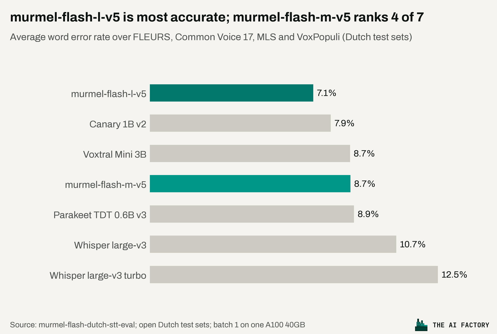
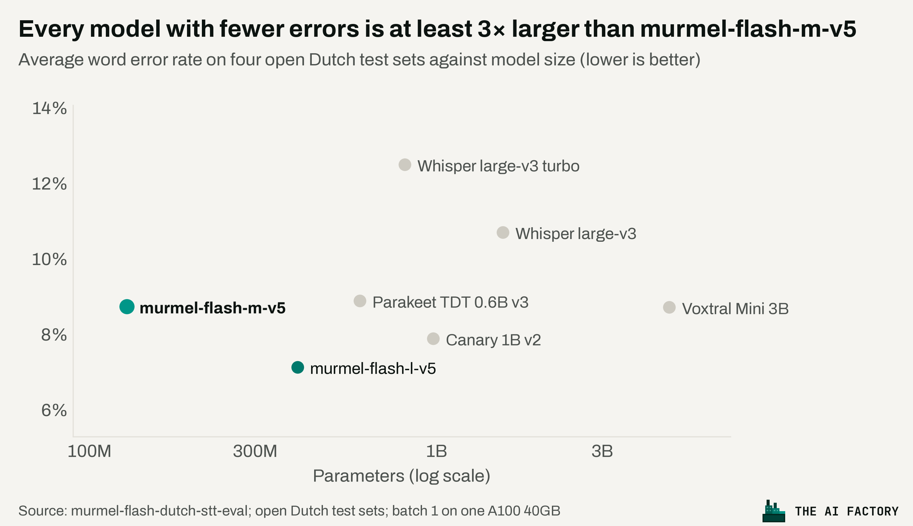

# murmel-flash-dutch-stt-eval

A reproducible benchmark of open-weights speech recognition models on **open Dutch test sets**: accuracy (word error
rate) and speed (real-time factor), every model on exactly the same audio, scored the same way.

It benchmarks [murmel-flash](https://github.com/The-AI-Factory/murmel-flash-dutch-stt) through its own package,
next to Whisper, NVIDIA Parakeet and Canary, and Mistral Voxtral. Anyone can rerun it: all models are open weights
and all test sets are openly licensed.

## Results




| Model | Publisher | FLEURS nl_nl | Common Voice 17.0 nl | Multilingual LibriSpeech Dutch | VoxPopuli nl | Average | Pooled | RTFx |
|---|---|---|---|---|---|---|---|---|
| murmel-flash-l-v5 ¹ | The AI Factory | 7.77 | 3.68 | 7.52 | 9.41 | **7.09** | 6.22 | 30 |
| nvidia/canary-1b-v2 | NVIDIA | 6.04 | 4.38 | 9.77 | 11.20 | **7.85** | 7.70 | 16 |
| mistralai/Voxtral-Mini-3B-2507 | Mistral AI | 5.80 | 5.02 | 9.83 | 14.05 | **8.68** | 8.25 | 7 |
| **murmel-flash-m-v5** | The AI Factory | 9.67 | 5.12 | 9.35 | 10.64 | **8.70** | 7.84 | 40 |
| nvidia/parakeet-tdt-0.6b-v3 | NVIDIA | 7.91 | 4.90 | 11.07 | 11.51 | **8.85** | 8.62 | 101 |
| openai/whisper-large-v3 | OpenAI | 5.56 | 4.23 | 9.82 | 23.06 | **10.66** | 8.80 | 8 |
| openai/whisper-large-v3-turbo | OpenAI | 6.03 | 5.82 | 9.60 | 28.38 | **12.46** | 9.85 | 37 |

WER in %, normalised (lowercase, no punctuation, digits as Dutch words, fillers removed); lower is better. Average =
mean of the four sets (each counts equally); Pooled = all words of all sets together, where Common Voice
weighs most. RTFx = seconds of audio per second of compute, one clip at a time on one A100 40GB; higher is faster.

¹ The larger murmel-flash model (397M parameters), benchmarked the same way for reference; not yet available as open
weights, so it is not in `models.txt` and `run_all.sh` does not run it.

Per-clip references, hypotheses and timings are in `results/<model>/<set>.jsonl`, the run settings and hardware in
`results/<model>/run.json`; [results/RESULTS.md](results/RESULTS.md) is generated by `bench/report.py`, the charts by
`bench/plots.py`.

## Test sets

| Set | Clips | Licence | Source |
|---|---|---|---|
| FLEURS nl_nl test | 364 | CC BY 4.0 | `google/fleurs` |
| Common Voice 17.0 nl test | 11,266 | CC0 1.0 | `fsicoli/common_voice_17_0` (complete mirror; Mozilla no longer hosts Common Voice on the Hub) |
| Multilingual LibriSpeech Dutch test | 3,075 | CC BY 4.0 | `facebook/multilingual_librispeech` |
| VoxPopuli nl test | 1,137 | CC0 1.0 | `facebook/voxpopuli` |

Only open test sets are used. Corpora that need a licence (CGN, JASMIN-CGN, N-Best) are left out so that every number
here can be reproduced by anyone.

## Models

Every model in [`models.txt`](models.txt) is available as open weights:

| Model | Params | Backend | Decoding |
|---|---|---|---|
| `theaifactorybv/murmel-flash-m-v5` | 128M | `murmel-flash` package | beam 4 (package default) |
| `openai/whisper-large-v3` | 1.55B | transformers | greedy, language nl |
| `openai/whisper-large-v3-turbo` | 809M | transformers | greedy, language nl |
| `nvidia/parakeet-tdt-0.6b-v3` | 600M | NeMo | default (TDT greedy) |
| `nvidia/canary-1b-v2` | 1B | NeMo | default, source and target language nl |
| `mistralai/Voxtral-Mini-3B-2507` | 4.7B | transformers | transcription mode, language nl, greedy |

`theaifactorybv/murmel-flash-m-v5` is gated with automatic approval: accept the terms on its Hugging Face page once
and log in (`hf auth login` or `HF_TOKEN`) before running it.

Each toolkit runs in its own virtual environment (they pin conflicting versions). Add a model by adding a line; add a
toolkit by adding `bench/backends/<name>.py` (a class with `transcribe(wave) -> str`) and `envs/<name>.txt`.

## How it is scored

- **WER**: corpus word error rate per set after normalisation (lowercase, punctuation removed, digits written out
  as Dutch number words, fillers like *uh*/*eh* removed), the same for every model.
  The average is the unweighted mean over the four sets (each set counts equally); the
  table also gives the pooled WER over all words of all sets, where the large Common Voice set weighs most.
- **Speed**: every clip goes through the model one at a time (batch 1), as when a user transcribes a file. The clock
  covers feature extraction, the model and decoding, not reading the file; the GPU is synchronised before it stops,
  and five clips are run first to warm up. **RTFx** = seconds of audio per second of compute (higher is faster).
  Batched throughput is higher for every model; batch 1 is the like-for-like latency view.
- Each model uses its own recommended decoding (see the table above), without an external language model.

## Run it

Needs [uv](https://docs.astral.sh/uv/), `ffmpeg`, and for representative speed an NVIDIA GPU (the published results
were run on one A100 40 GB). About 34 hours of audio per model; the full run takes a few hours on an A100.

```bash
git clone https://github.com/The-AI-Factory/murmel-flash-dutch-stt-eval
cd murmel-flash-dutch-stt-eval
./run_all.sh                            # all sets, all models -> results/RESULTS.md
MAX_CLIPS=100 ./run_all.sh              # quick check: 100 evenly spaced clips per set
SETS="fleurs voxpopuli" ./run_all.sh    # some sets only
```

Or step by step:

```bash
uv venv venvs/base && uv pip install --python venvs/base/bin/python -r envs/base.txt
venvs/base/bin/python -m bench.sets                       # download the test sets into data/
uv venv venvs/whisper && uv pip install --python venvs/whisper/bin/python -r envs/base.txt -r envs/whisper.txt
venvs/whisper/bin/python -m bench.run --backend whisper --model openai/whisper-large-v3-turbo
venvs/base/bin/python -m bench.report
```

Runs are resumable: a set already in `results/<model>/<set>.jsonl` continues where it stopped.
